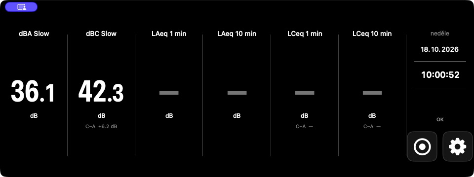

# SPL Man

SPL Man is a native macOS sound level meter for live sound workflows, designed
for wide 1920 × 480 displays. It provides calibrated A-, C-, and Z-weighted
measurements, rolling Leq metrics, peak monitoring, spectrogram and transfer
function analysis, CSV recording, and session history.

## Application preview



## Download

Download [SPL Man for Apple silicon](dist/SPLMan-macOS-arm64.zip), extract the
archive, and move `SPLMan.app` to Applications. The build requires macOS 13 or
later and is ad hoc signed but not notarized.

## Build

Requires macOS 13 or later and Swift 6:

```sh
zsh ./test.sh
zsh ./build-app.sh
open dist/SPLMan.app
```

On first launch, grant microphone access. In Settings, select a specific device
and channel, attach a 1 kHz calibrator, and select **Calibrate at 94 dB**. The
app lets the Slow integrator settle for 6 seconds and then verifies both signal
stability and concentration around 1 kHz, so calibration takes at least 9 seconds. After
calibration, remove the calibrator and select **Start Input** so the time windows
begin without the calibration tone. The app never switches to another device
automatically. If the saved input is unavailable, measurement remains stopped.

Settings are divided into five sections: input and calibration, displayed
measurements, analysis, alerts and alarms, and recording and history. Under
displayed measurements, you can choose which values appear and change the order
of the display columns.

## Measurements

- LAeq, LCeq, and LZeq for each completed second, including LAFmax, LASmax, and
  LCpeak for the same one-second interval
- Rolling LAeq over 1, 10, 15, and 30 minutes and rolling LCeq over 1, 10, and
  30 minutes; each value appears only after its full time window has elapsed
- SPL A Slow and SPL C Slow
- LCpeak for short C-weighted peaks
- LAFmax, the highest fast-response A-weighted value since the input was started
- C−A for 1-minute LCeq, 10-minute LCeq, and SPL C Slow

LAFmax and LCpeak are maxima since the input was started and reset when the
input is restarted. LCpeak has no corresponding A-weighted peak metric, so C−A
is not shown for it.

## Analysis

The analysis section of Settings selects what is displayed: the spectrogram, the
transfer function, both, the meter bridge of a connected mixing console, or
nothing (the default). None of these views affects the measured values.

### Spectrogram

The spectrogram runs behind the measurements and shows relative signal energy
normalized to 1/24-octave bandwidth. After calibration, its colors show an approximate
unweighted level (Z); without calibration, they use a relative dBFS scale ending
at 0 dBFS. You can adjust:

- Frequency range: 20 Hz–20 kHz, 50 Hz–10 kHz, or 100 Hz–5 kHz; the actual upper
  limit depends on the input sample rate
- History: 10, 30, or 60 seconds
- Intensity and color scale
- Upper limit (40–140 dB, default 100 dB) and dynamic range (10–100 dB, default
  50 dB)

### Transfer function

The transfer function compares the measurement channel with a selected reference
channel, so it requires an input with at least two channels. The curve uses
continuous impulse-response alignment and frequency-dependent time windowing,
and is averaged over 5 seconds.

- Smoothing: 1/48, 1/24, 1/12, 1/6, 1/3, or 1 octave (default 1/6); changing it
  restarts only the curve averaging
- Vertical range: ±3 to ±60 dB (default ±12 dB), centered automatically, with
  reference lines every 6 dB
- Coherence: the trace fades out where coherence drops below 0.8, reaching its
  minimum at 0.3, so unreliable parts of the curve are easy to recognize

## Mixing console meter bridge

SPL Man can show the level meters of a mixing console behind the measurements.
Behringer WING consoles and Behringer X32 / Midas M32 consoles are supported
through the small built-in `WingKit` and `X32Kit` libraries; the application is
structured so that other consoles can be added as further drivers.

Under **Mixing console** in Settings, select the console type. Leave the address
empty to find the console on the network automatically, or enter its IP address
if it is on another network or automatic discovery does not find it. Then select
**Meter bridge** in the analysis section or with the analysis button on the
display. The console connection only reads data and never changes the console.

Once configured, SPL Man connects by itself at launch. If the console is not
available or the connection is lost, it retries about every 5 seconds without
showing any messages; the current state is shown in Settings. On first use,
macOS asks for permission to access the local network.

Each part of the console, such as channels, aux, buses, mains, matrices, inputs,
and outputs, is shown as a separate section, and sections can be switched on or
off in Settings. On a WING, DCAs are available as well, and of the physical inputs
and outputs only the local connectors are shown by default. WING strips have a
left and a right bar, because every WING strip can be stereo; X32 strips have one
bar, except main LR and the effect returns. The sections wrap into two rows when
one row would make the bars too narrow. Bars are green below -18 dB, yellow from
-18 dB, and red from 0 dB.

## Wireless microphones

SPL Man can show the channels of Shure wireless receivers behind the
measurements: the channel name, the transmitter's battery, the audio level, and
the received signal strength. SLX-D, SLX-D+ (including the quad SLXD4Q+) and ULX-D
receivers are read through the small built-in `ShureKit` library, based on Shure's
published command strings. QLX-D
receivers use the same commands as ULX-D, but this has not been checked against a
Shure document.

Under **Wireless microphones** in Settings, switch on monitoring, then select
**Wireless microphones** in the analysis section or with the analysis button on
the display. Receivers are found in three ways:

- **Automatically:** SPL Man listens for what receivers announce on the network
  (SLP multicast on 239.255.254.253, port 8427). Shure does not document this for
  third parties and it has only been described for QLX-D, so other models may not
  appear this way.
- **By address:** enter the IP addresses of receivers, separated by commas.
- **By scanning:** **Scan Network** asks every address in the Mac's /24 subnet for
  its model on TCP port 2202. It runs only when you press the button, because it
  contacts every device on the network.

The connection only reads data and never changes a receiver. For that reason it
requests levels about 8 times per second instead of using the receiver's own
metering, which would have to be switched on with a setting. Receivers that are
lost keep their column, marked as offline, and are retried about every 5 seconds.

The audio bar is green below -18 dBFS, yellow from -18 dBFS, and red at 0 dBFS. The
signal bar shows -100 to -40 dBm, and is red below -85 dBm, yellow below -70 dBm,
and green above; these thresholds are a practical guide, not a Shure specification.
Other Shure models, such as Axient Digital, are not supported: discovery and
scanning skip them, and an address entered for one is listed as not supported.

## Recording, sessions, and history

Once the input is running and calibrated, use the Record button next to
Settings to choose a CSV file and start saving measurements. During recording,
the button changes to Stop and the elapsed time is displayed. Before saving,
you can enter an event name, location, note, and microphone identification.
Recent sessions and their status are available in the history. For each session,
you can view the latest 100 stored events, gaps, and errors.

The CSV uses UTC timestamps taken from the system clock for each audio buffer, so
sound-card clock drift does not accumulate over long sessions. It contains the session identifier and status,
processed frame and second counts, one-second and long-term metrics, and input,
channel, and calibration identification. In addition to samples, it records
status events, alarms, gaps, and errors. An invalid or missing interval is not
replaced with the last value; it is preserved as an invalid sample or an
explicit `gap` or `error` row. The first audio second that began before Record
was selected is not written as a valid sample. Values whose time windows are
not yet complete have an empty CSV field.

Recording ends safely when Stop is selected, the input changes or disconnects,
calibration begins, a write error occurs, or the app quits. Recording does not
resume automatically when the app is relaunched.

The optional concert alarm monitors 30-minute LAeq and one-second LCpeak. The
default reference values are 99 dB and 135 dB and can be changed in Settings.
Both threshold crossings and returns below the threshold are recorded as
session events.

The default color transition spans 95–100 dB(A) and 105–110 dB(C). It is an
adjustable visual warning for live sound, not an occupational health or legal
limit.

Single-point calibration and software tests do not replace type or periodic
verification of the complete measurement system under IEC 61672. The concert
alarm is not a declaration of compliance with DIN 15905-5.

## License

SPL Man is source-available under the [SPL Man Free Use License](LICENSE). It
may be downloaded, compiled without changes, installed, and used free of charge
for personal or commercial purposes. Modification, derivative works,
redistribution, sublicensing, and sale are not permitted without prior written
permission. Normal use includes changing settings, calibrating the application,
entering session details, and creating or exporting measurements and CSV files.

This is not an open-source license. The official repository and releases are
maintained by Radim Kuncicky.