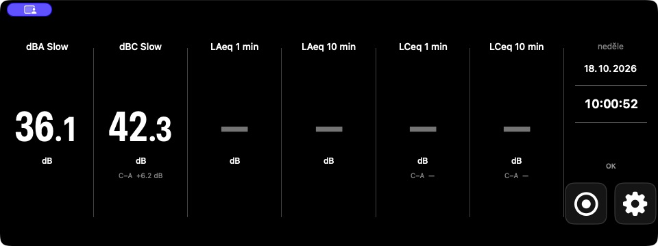

# SPL Man

SPL Man is a native macOS sound level meter for live sound workflows, designed
for wide 1920 × 480 displays. It provides calibrated A-, C-, and Z-weighted
measurements, rolling Leq metrics, peak monitoring, CSV recording, and session
history.

## Application preview



## Build

Requires macOS 13 or later and Swift 6:

```sh
zsh ./test.sh
zsh ./build-app.sh
open dist/SPLMan.app
```

On first launch, grant microphone access. In Settings, select a specific device
and channel, attach a 1 kHz calibrator, and select **Calibrate at 94 dB**. The
app verifies both signal stability and concentration around 1 kHz. After
calibration, remove the calibrator and select **Start Input** so the time windows
begin without the calibration tone. The app never switches to another device
automatically. If the saved input is unavailable, measurement remains stopped.

## Measurements

- LAeq, LCeq, and LZeq for each completed second, including LAFmax, LASmax, and
  LCpeak for the same one-second interval
- Rolling LAeq over 1, 10, 15, and 30 minutes and rolling LCeq over 1, 10, and
  30 minutes; each value appears only after its full time window has elapsed
- SPL A Slow and SPL C Slow
- LCpeak for short C-weighted peaks
- LAFmax, the highest fast-response A-weighted value since the input was started
- C−A for 1-minute LCeq, 10-minute LCeq, and SPL C Slow

LAFmax and LCpeak are maxima since the input was started and reset when the
input is restarted. LCpeak has no corresponding A-weighted peak metric, so C−A
is not shown for it.

## Recording, sessions, and history

Once the input is running and calibrated, use the Record button next to
Settings to choose a CSV file and start saving measurements. During recording,
the button changes to Stop and the elapsed time is displayed. Before saving,
you can enter an event name, location, note, and microphone identification.
Recent sessions and their status are available in the history. For each session,
you can view the latest 100 stored events, gaps, and errors.

The CSV uses UTC timestamps and contains the session identifier and status,
processed frame and second counts, one-second and long-term metrics, and input,
channel, and calibration identification. In addition to samples, it records
status events, alarms, gaps, and errors. An invalid or missing interval is not
replaced with the last value; it is preserved as an invalid sample or an
explicit `gap` or `error` row. The first audio second that began before Record
was selected is not written as a valid sample. Values whose time windows are
not yet complete have an empty CSV field.

Recording ends safely when Stop is selected, the input changes or disconnects,
calibration begins, a write error occurs, or the app quits. Recording does not
resume automatically when the app is relaunched.

The optional concert alarm monitors 30-minute LAeq and one-second LCpeak. The
default reference values are 99 dB and 135 dB and can be changed in Settings.
Both threshold crossings and returns below the threshold are recorded as
session events.

The default color transition spans 95–100 dB(A) and 105–110 dB(C). It is an
adjustable visual warning for live sound, not an occupational health or legal
limit.

Single-point calibration and software tests do not replace type or periodic
verification of the complete measurement system under IEC 61672. The concert
alarm is not a declaration of compliance with DIN 15905-5.
